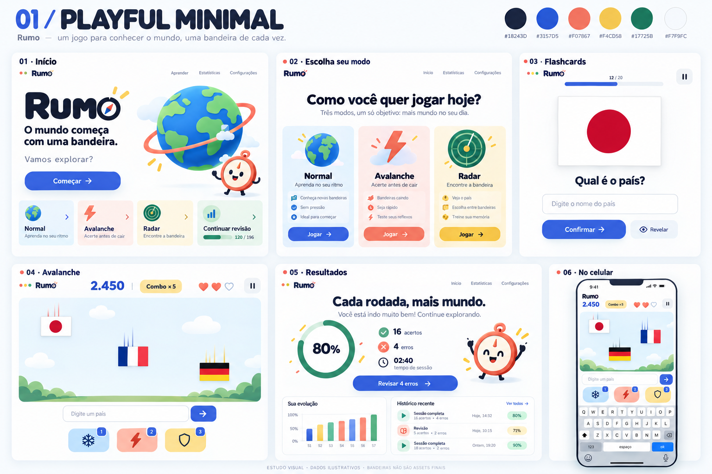
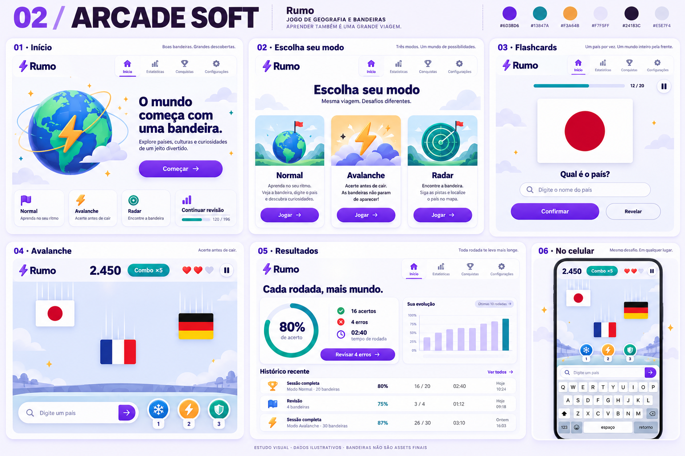
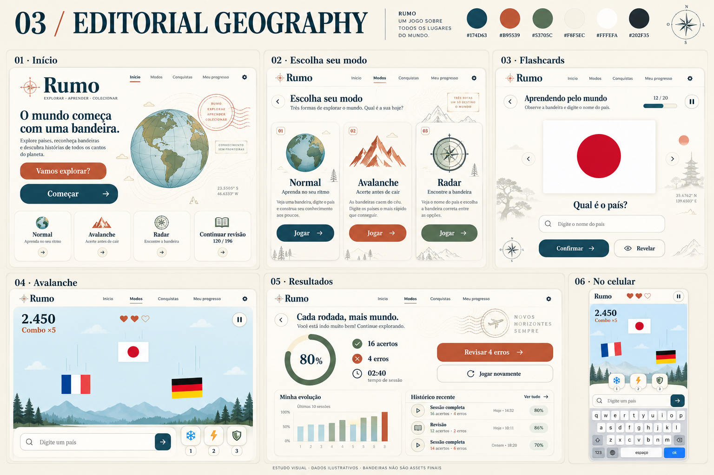
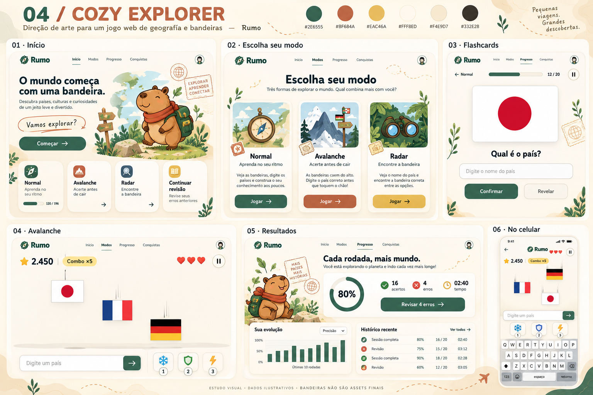

# Rumo — propostas de direção visual

> Registro histórico: o usuário aprovou a proposta 2, Arcade Soft, e escolheu o nome provisório Geo. A implementação e as instruções atuais estão no README.md. O restante deste documento preserva a etapa original de propostas.

Etapa 1 · 9 de outubro de 2026 · Nome provisório · Aguardando escolha visual

Este material apresenta identidade visual, mockups estáticos e planejamento. Nenhum código do jogo foi escrito. As etapas de implementação só começam depois da aprovação da identidade visual.

## Como comparar

As quatro pranchas usam o mesmo nome provisório e o mesmo conteúdo. Cada uma apresenta início, seleção de modos, flashcards, Avalanche, resultados com estatísticas e uma adaptação do Avalanche para celular. São 20 telas principais e quatro estudos mobile.

Os números são demonstrativos. Bandeiras desenhadas nos mockups são ilustrações de contexto: não serão extraídas nem usadas como bandeiras oficiais no jogo. Textos pequenos, gráficos, formas e proporções gerados por imagem não constituem especificação final. As decisões escritas neste documento orientam a implementação após aprovação.

| Proposta | Personalidade | Melhor atributo | Principal cuidado |
| --- | --- | --- | --- |
| 1. Playful Minimal | Alegre, clara, contemporânea | Equilíbrio entre estudo e diversão | Evitar uma aparência genérica de app educacional |
| 2. Arcade Soft | Energética, tátil, competitiva | Personalidade para Avalanche e Radar | Controlar estímulos em sessões longas |
| 3. Editorial Geography | Sofisticada, curiosa, cartográfica | Organização do conteúdo e coleção | Preservar sensação de jogo no arcade |
| 4. Cozy Explorer | Acolhedora, ilustrada, exploratória | Vínculo com a prática diária | Não infantilizar nem encobrir as bandeiras |

## Sugestões de nomes

| Nome | Ideia | Observação |
| --- | --- | --- |
| **Rumo** | Uma pequena jornada de aprendizado a cada partida | Minha escolha: curto e permite futuros módulos |
| ViraMundo | Curiosidade, movimento e descoberta | Mais expressivo e brincalhão |
| Bandeirama | Bandeiras com personalidade de jogo | Explica o módulo inicial, mas limita a marca futura |
| Atlas em Jogo | Geografia acessível e divertida | Muito claro, porém mais comprido |
| Ponto Norte | Orientação e progresso | Combina especialmente com Editorial Geography |
| Mundo à Vista | Descoberta e reconhecimento visual | Acolhedor, bom para Cozy Explorer |

Assinatura sugerida: **“O mundo começa com uma bandeira.”** Rumo é apenas o nome usado para comparar as imagens. Não foi feita pesquisa de disponibilidade de marca, domínio ou nome de repositório.

## 1. Playful Minimal

**Ideia:** um brinquedo digital elegante, fácil de compreender em segundos. A bandeira é o elemento mais importante; as cores da interface organizam a experiência.

**Paleta:** fundo `#F7F9FC`, superfície `#FFFFFF`, texto `#18243D`, ação principal azul `#3157D5`, coral decorativo `#F07867`, amarelo decorativo `#F4CD58`, acerto verde `#17725B`.

**Tipografia:** Plus Jakarta Sans 600–800 em títulos e DM Sans 400–600 no corpo. Números tabulares em pontuação e temporizadores. Fontes mostradas nas imagens são aproximações visuais; os arquivos reais serão incorporados após a escolha.

**Componentes:** cards com raio de 20 px, campos de 12 px, botões de 14 px e altura mínima de 48 px. Sombras leves, bordas discretas, ícones Lucide arredondados de 24 px. Normal usa azul; Avalanche recebe coral como detalhe; Radar, verde. O rótulo e o ícone sempre acompanham a cor.

**Animações e efeitos:** pressão do botão em 100 ms; troca de cartão em 180 ms; check de acerto em 180 ms; poucos confetes ao concluir uma revisão. Som curto e suave para acerto, opcional. Sem tremer a bandeira ao errar.

**Mascote possível:** uma pequena bússola chamada Norte, presente na recepção e nas conquistas. A prancha sugere um personagem circular; seu desenho final deverá enfatizar uma agulha de bússola, para não parecer um cronômetro.

**Vantagens:** boa legibilidade; adaptação simples aos três modos; componentes reutilizáveis; fácil expansão para mapas e capitais. **Desvantagens:** depende de tipografia e detalhes próprios para se diferenciar; excesso de formas arredondadas pode parecer infantil.

## 2. Arcade Soft

**Ideia:** a energia de um arcade em uma interface clara, com pontuação e combos que dão satisfação sem competir com as bandeiras.

**Paleta:** fundo `#F7F5FF`, superfície `#FFFFFF`, texto ameixa `#24183C`, violeta principal `#6D38D6`, verde azulado `#13847A`, laranja decorativo `#F3A64B`.

**Tipografia:** Space Grotesk 600–700 nos títulos e placares; Inter 400–600 no corpo. Dígitos grandes e estáveis, sem fontes pixeladas nos controles.

**Componentes:** cards de 16 px; botões com pequeno relevo inferior de 3 px; chips de combo; poderes em fichas de formas distintas. Ícones Lucide com traço ligeiramente mais forte e símbolos próprios de raio, escudo e gelo.

**Animações e efeitos:** botão comprime o relevo em 90 ms; combo pulsa uma vez em 180 ms; eliminação produz 4–6 partículas por até 250 ms. Som de combo com progressão curta, sem repetir uma fanfarra a cada acerto. Congelamento destacado na borda do campo, nunca sobre a bandeira.

**Mascote possível:** um pequeno satélite chamado Pulsar, usado apenas fora das rodadas.

**Vantagens:** maior personalidade arcade; bom feedback de ritmo, risco e recompensa; recordes ganham destaque. **Desvantagens:** maior trabalho de balancear animações e áudio; pode cansar se efeitos aparecerem continuamente; placares não devem dominar o modo Normal.

## 3. Editorial Geography

**Ideia:** um atlas contemporâneo que convida a jogar. Linhas cartográficas, títulos expressivos e selos de descoberta dão profundidade sem poluir a interface.

**Paleta:** fundo marfim `#F8F5EC`, superfície `#FFFEFA`, texto `#202F35`, azul oceano principal `#174D63`, terracota `#B95539`, verde oliva `#53705C`.

**Tipografia:** Fraunces 600 nos títulos de apresentação; Source Sans 3 400–600 em perguntas, controles, tabelas e números. A serifa não aparece em campos de resposta nem em placares críticos.

**Componentes:** cards com raio de 14 px; botões de 12 px; linhas finas, abas e etiquetas que lembram capítulos de atlas. Ícones Lucide finos, sempre com bom contraste. Textura e curvas de nível limitadas à recepção e às margens.

**Animações e efeitos:** entrada por opacidade e deslocamento de 8 px em 220 ms; linha de progresso que se completa suavemente; selo de conquista em 200 ms. Sons discretos de toque, sem simular páginas durante toda a sessão.

**Mascote possível:** nenhuma mascote fixa; um selo de andorinha ou uma rosa dos ventos pode representar as conquistas.

**Vantagens:** identidade geográfica forte; excelente para coleção, histórico e futuros conteúdos; aparência duradoura. **Desvantagens:** exige cuidado para não parecer material didático estático; Avalanche precisa de sinais de velocidade mais fortes; títulos serifados pedem controle de tamanho no celular.

## 4. Cozy Explorer

**Ideia:** aprender como quem faz pequenas viagens. Uma personagem acolhe e comemora, sem cobrar presença diária nem transformar erros em punição.

**Paleta:** fundo creme `#FFF8ED`, superfície `#FFFDFA`, texto `#332E28`, verde floresta principal `#2E6555`, terracota `#BF684A`, mel decorativo `#EAC46A`.

**Tipografia:** Nunito Sans 600–800 nos títulos e DM Sans 400–600 no corpo. Controles permanecem claros e regulares; não usar letras manuscritas em perguntas.

**Componentes:** cards de 24 px, botões de 16 px, sombras quentes suaves e pequenos selos de viagem. Ícones de interface com traço consistente; ilustrações orgânicas apenas em espaços decorativos.

**Animações e efeitos:** personagem acena na entrada em até 600 ms; cartão surge em 220 ms; conquista recebe um selo em 250 ms. Sons leves de madeira ou sinos, opcionais e curtos. Mascote fica estática com movimento reduzido.

**Mascote possível:** Capi, uma capivara exploradora com mochila e lenço. Ela aparece no início, em estados vazios e nos resultados; fica ausente do campo de jogo.

**Vantagens:** identidade afetiva memorável; boa para prática sem pressão; potencial para conquistas colecionáveis. **Desvantagens:** exige mais ilustrações e manutenção de estilo; pode parecer infantil; textura e decoração precisam ficar fora das bandeiras.

## Minha recomendação

**Rumo + Playful Minimal.** É a base mais equilibrada para aprender, reconhecer rapidamente e jogar partidas longas. O azul oferece hierarquia consistente, os detalhes coloridos distinguem os modos e a mesma estrutura suporta estatísticas mais densas.

No Avalanche, recomendo usar a linguagem de feedback do Arcade Soft — combo, pressão dos botões e partículas curtas — preservando as cores, fontes e formas do Playful Minimal. Isso é um tratamento de estado do jogo, não uma segunda identidade.

Se sua prioridade for personalidade ilustrada, Cozy Explorer é a alternativa mais distinta. Se quiser a aparência mais adulta e cartográfica, Editorial Geography é a melhor opção.

## Regras compartilhadas para a futura interface

- Grade de espaçamento de 4/8 px; conteúdo desktop até aproximadamente 1200 px; margens mobile de 16–20 px. Corpo de texto a partir de 16 px; rótulos auxiliares de 14 px.
- Alvos de toque de pelo menos 44 × 44 px, preferindo 48 px nos controles frequentes. Foco visível, ordem de teclado coerente e nome acessível para ícones.
- Verificar contraste de texto e controles antes de aprovar tokens finais. Tons amarelos, coral claro e mel ficam em decoração ou com texto escuro, não em texto pequeno sobre branco.
- Acerto: check + mensagem + cor. Erro: ícone + resposta correta + cor. Sons nunca são a única informação.
- Bandeiras exibidas inteiras, sem recorte, distorção, filtros ou cantos arredondados aplicados ao desenho. O contêiner pode ter cantos arredondados e margem interna.
- Feedback de movimento reduzido usa texto, borda e opacidade. Sem tremor de tela, flashes ou confete contínuo.
- Menu desktop em três cards; no celular, cards empilhados. Configurações em etapas curtas para evitar formulários extensos.
- No Normal, teclado virtual não pode cobrir resposta, feedback ou botão principal. No Avalanche, recalcular área útil quando o teclado abre, pausar ao perder foco e deixar poderes junto ao campo de resposta.
- Atalho padrão de pausa: Esc e botão visível. Espaço continua disponível para nomes como “África do Sul”. Se oferecido como pausa, só funciona fora do campo de texto. Poderes por números devem considerar composição de texto e teclado mobile.
- No Radar, número de colunas e tamanho mínimo determinam o limite de bandeiras por tela. Uma variante com rolagem deve ter recordes próprios, pois muda o custo de busca visual.
- Resultados diferenciam sessão completa e revisão. Precisão não é sinônimo de domínio. A ação principal do Normal é revisar os erros restantes; ao zerar, mostrar conclusão e futuras revisões.
- Estado vazio de progresso apresenta convite para jogar, sem inventar números. Nas pranchas, todos os dados são ilustrativos.

## Ajustes previstos ao transformar o mockup aprovado em especificação

As pranchas são explorações de imagem. Antes da programação, consolidar tokens e layout da direção escolhida. A tipografia exata será a indicada no documento. Remover qualquer cenário decorativo que tenha aparecido dentro do Avalanche; manter o fundo limpo. Reproduzir gráficos com rótulos corretos e separar visualmente os tipos de sessão. Substituir todas as bandeiras ilustradas por SVGs validados. Dimensionar a interface em pixels reais e testar com teclado virtual; a imagem mobile mostra intenção, não valida funcionamento.

Na prancha Editorial, retirar o templo e as coordenadas associados ao Japão durante a pergunta: dariam uma pista involuntária. Em todas as propostas, padronizar a descrição do Radar para “Veja o nome e encontre a bandeira na grade”; textos que mencionam localizar países no mapa não representam a mecânica solicitada. Os pequenos gráficos misturam categorias e têm rótulos ilustrativos; no produto, sessão completa e revisão terão séries identificadas separadamente. Os estudos mobile ainda exigem ajuste de tamanho de toque e área útil em aparelho real.

## Plano técnico resumido — somente proposta

### Arquitetura

**Interface:** React + TypeScript + Vite, tokens de design e Tailwind, componentes acessíveis, Lucide para ícones. CSS para microanimações; biblioteca adicional apenas se uma necessidade concreta justificar. Recharts para gráficos acompanhados de resumo textual e tabela acessível.

**Domínio:** catálogo de países separado dos motores Normal, Avalanche e Radar. Um núcleo comum registra respostas, confusões, sessões, revisão espaçada, domínio, XP e conquistas. Funções de pontuação e seleção são determinísticas com relógio e gerador aleatório controláveis nos testes. O módulo de bandeiras deve permitir novos módulos sem alterar o histórico anterior.

**Dados locais:** IndexedDB, com camada de repositórios e migrações versionadas. Separar preferências, eventos de resposta, sessões, revisões, domínio, recordes e conquistas. Agregados derivados dos eventos podem ser recalculados. Salvar resposta e progresso em transação; importações passam por validação, versão e proteção contra duplicatas. Exportação JSON com backup anterior à restauração.

**Aprendizagem:** revisão encadeada mantém o vínculo com a sessão original e reduz apenas a lista de erros pendentes. Histórico de dificuldade nunca é apagado por um acerto. Domínio e repetição espaçada serão fórmulas documentadas e testadas; tempo de resposta entra com cuidado, distinguindo digitação de reconhecimento e desktop de celular. Não atribuir precisão científica a uma heurística de aprendizagem.

**Avalanche:** proposta inicial de DOM para bandeiras SVG e controles, com posições atualizadas por `requestAnimationFrame` e transformações, sem atualizar toda a árvore React a cada quadro. Justificativa: boa legibilidade, semântica, integração com foco e teclado, manutenção simples e quantidade de objetos limitada pelo próprio balanceamento. Simulação separada da renderização. Canvas 2D fica como opção para partículas ou se medições indicarem gargalo; não é necessário para substituir os campos e botões acessíveis.

**Tempo e justiça:** movimento usa tempo decorrido; aba oculta provoca pausa e não acumula queda ao retornar. Entrada e colisões têm ordem determinística. Duplicatas eliminam primeiro a bandeira mais próxima do chão. Limitar concorrência e intervalo de surgimento segundo tempo de resposta disponível. Recordes separados por preset, poderes, entrada e parâmetros relevantes.

**Offline:** fontes e SVGs locais, cache de recursos versionado e service worker após definir a política de atualização. Offline só será prometido após teste de carregamento completo e reabertura sem rede. Atualização do cache não deve apagar IndexedDB. Interrupções preservam o estado ou registram sessão interrompida, sem fabricar resultados finais.

**Publicação:** build estático, base do Vite correspondente ao repositório e rotas por hash para evitar falhas ao recarregar URLs no GitHub Pages. CI executa testes e build antes do deploy. A documentação oficial do Vite descreve a base `/<REPO>/` e publicação com Actions: [Deploying a Static Site](https://vite.dev/guide/static-deploy.html).

### Sequência e critérios de saída

| Fase futura | Entrega | Critério para avançar |
| --- | --- | --- |
| A — Fundação | Design system aprovado, navegação, catálogo, persistência | 196 entradas conferidas; assets e licenças auditados; dados sobrevivem a recarga |
| B — Normal | Quatro formatos e ciclo completo de revisão | Revisar até zerar sem apagar histórico; alternativas distintas; nomes seguros |
| C — Avalanche | Motor, vidas, presets, combos, poderes e eventos | Jogável em desktop/mobile; pausa confiável; pontuação e limites testados |
| D — Radar | Grades, dificuldades, tempo, eventos e resultados | Uma resposta correta por rodada; toque/teclado funcionais; registros integrados |
| E — Progresso | Domínio, gráficos, histórico, conquistas e backups | Três modos alimentam os mesmos dados; importação/exportação verificadas |
| F — Polimento | Animação, áudio, responsividade e acessibilidade | Todas as telas revisadas; movimento reduzido e teclado testados |
| G — Publicação | README, licenças, documentação e GitHub Actions | Build e testes passam; versão publicada aberta e conferida no endereço real |

Vitest cobre regras, geração de alternativas, revisão, pontuação, migrações e serialização. Playwright cobre jornadas reais: completar e revisar sessão, recarregar, reabrir, importar backup e jogar com teclado. Casos de colisão simultânea, duplicatas, nenhum erro, todos os erros, perda de foco e modo offline entram nos critérios das respectivas fases.

### Pendência de dados e licenças

A consulta à [referência JetPunk](https://www.jetpunk.com/user-quizzes/176134/bandeiras-do-mundo) recebeu HTTP 403 nesta etapa. **A equivalência exata da lista de 196 países não está verificada.** Antes de montar o catálogo, conferir a lista, documentar explicitamente Taiwan, Kosovo, Palestina e Vaticano e, se a referência continuar inacessível, apresentar uma lista candidata para validação. Esta etapa não fixa nenhuma convenção por presunção.

O projeto [flag-icons](https://github.com/lipis/flag-icons) informa licença MIT, mas sua documentação apresenta formatos padronizados 4:3 e 1:1. Por isso não deve ser adotado automaticamente para o requisito de proporções oficiais. Selecionar SVGs de fontes verificáveis, conferir cada proporção e símbolo e manter um manifesto por arquivo com URL, autoria, licença, atribuição, data e eventuais adaptações. Nenhuma imagem gerada será fonte de bandeira oficial.

Fontes sugeridas podem ser consultadas no [Google Fonts](https://fonts.google.com/). A seleção final inclui conferir a licença de cada família e salvar o respectivo texto junto dos arquivos locais. Ainda não há pacote de fontes ou bandeiras redistribuído nesta pasta.

## Decisão solicitada

Escolher uma direção de 1 a 4 e, opcionalmente, o nome preferido. Minha indicação é **1 — Playful Minimal, com o nome Rumo**. A implementação continua aguardando essa escolha, conforme solicitado no briefing.
