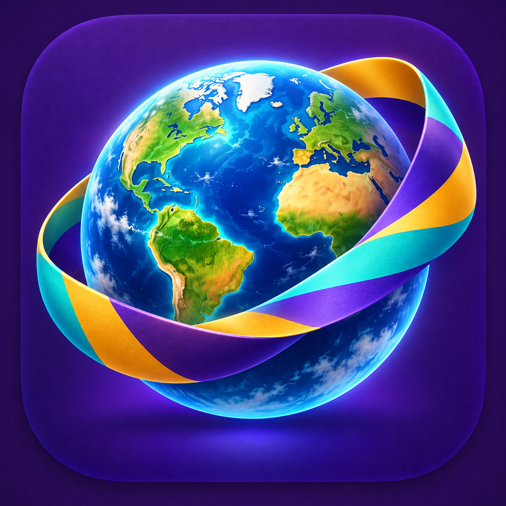
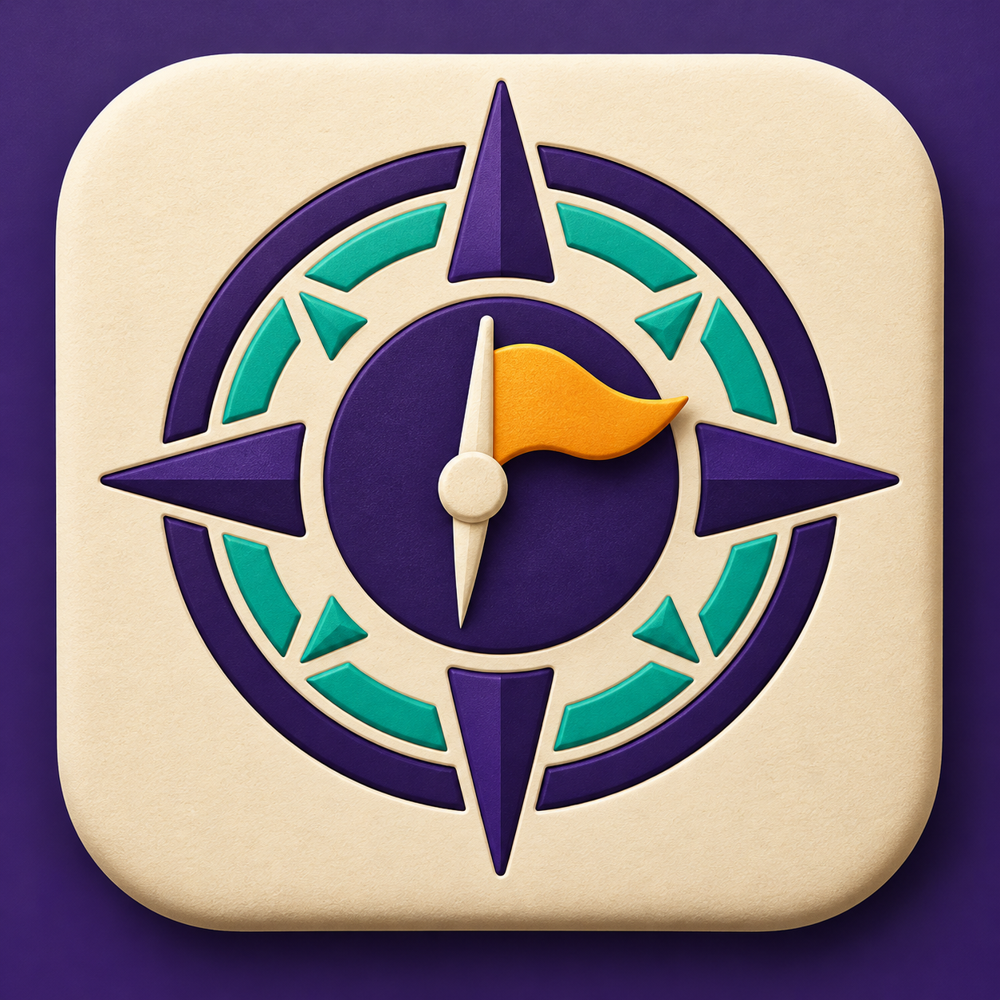
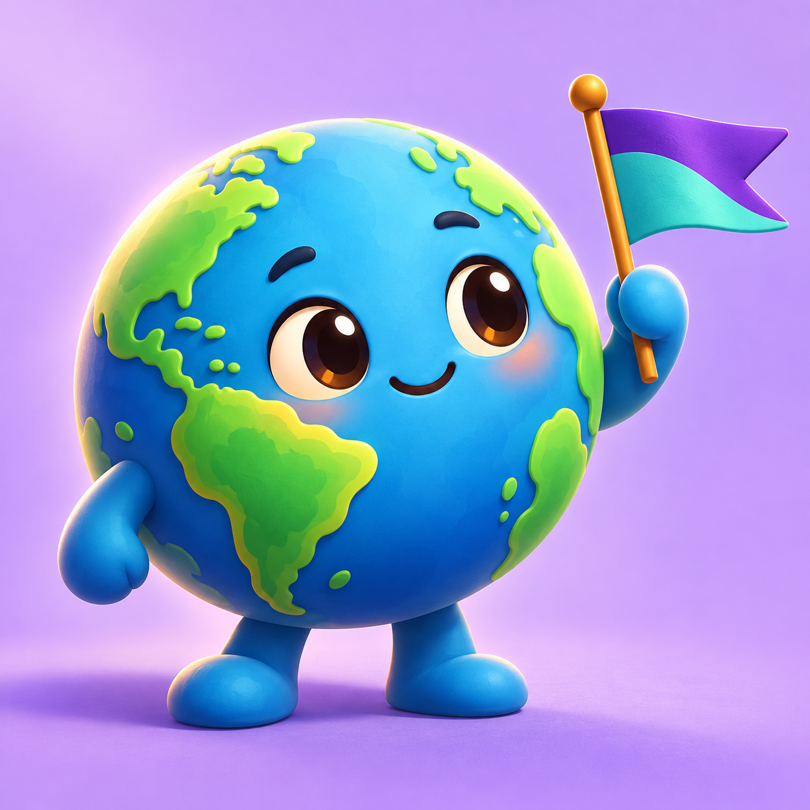
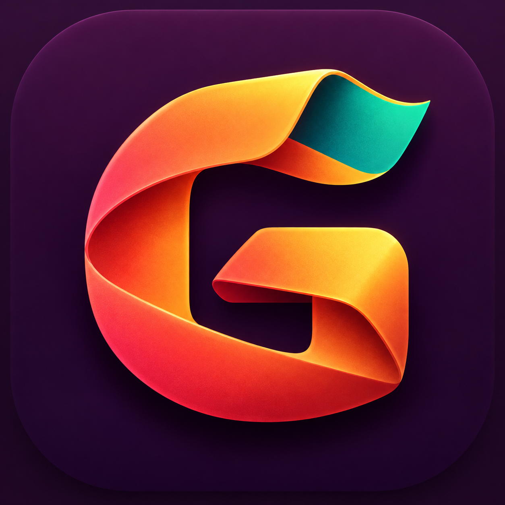
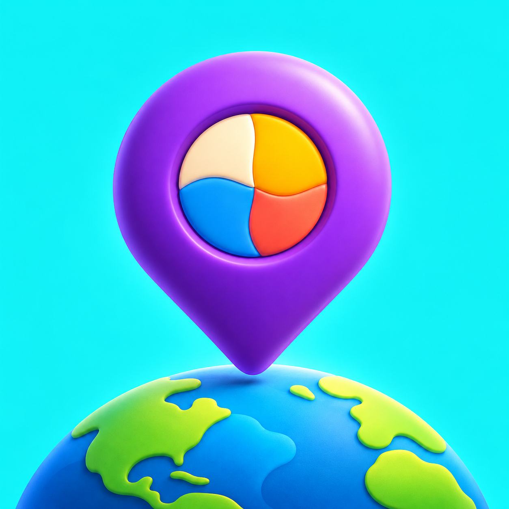
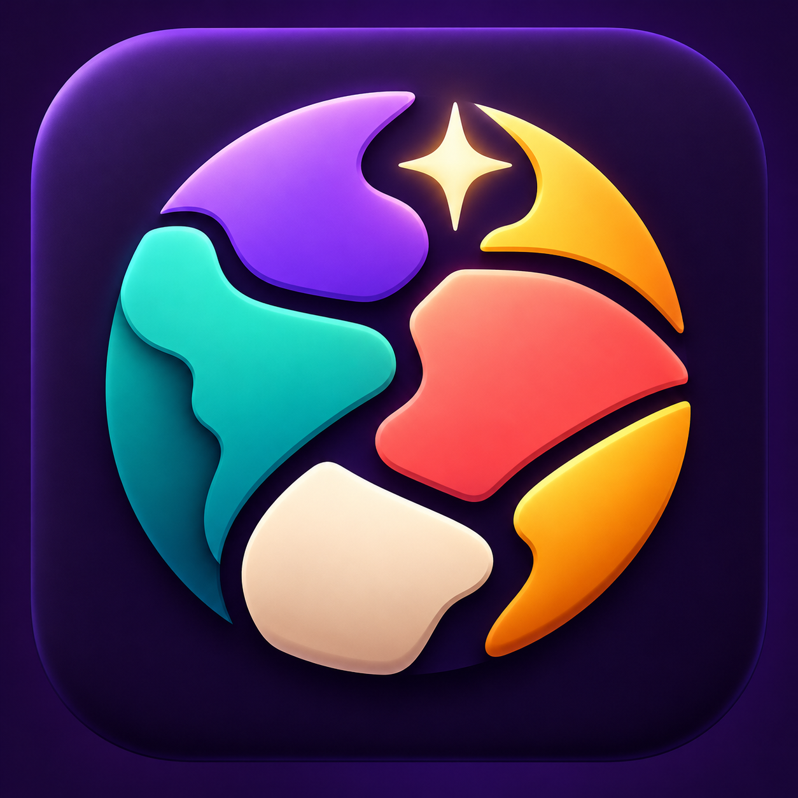
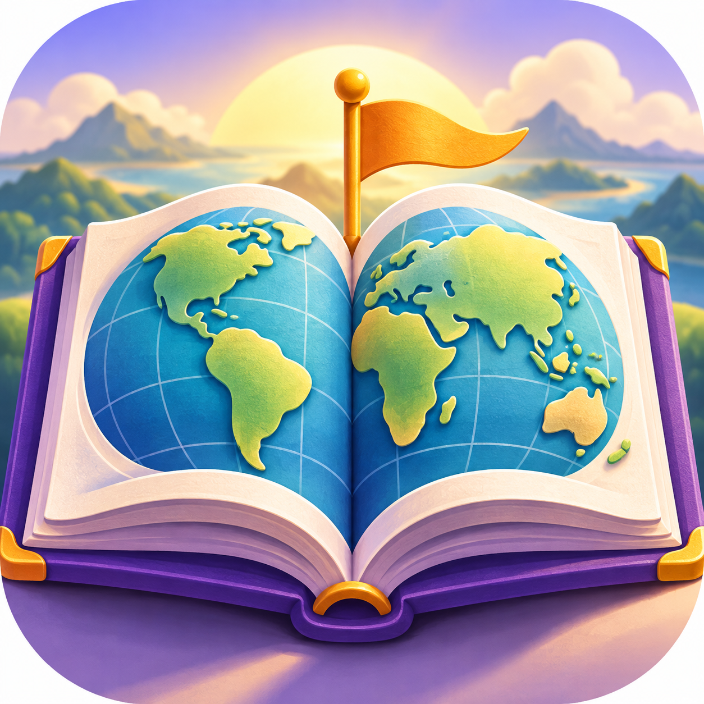
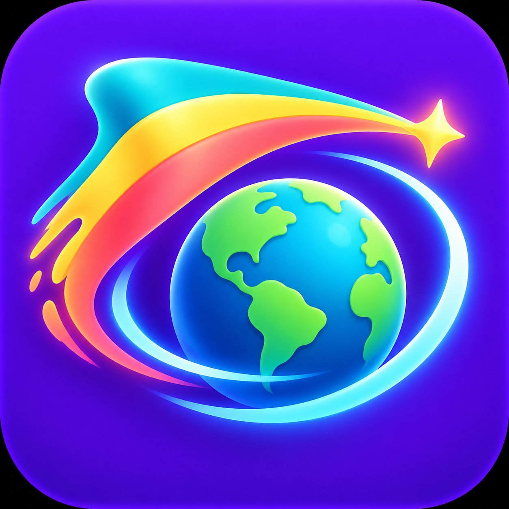

# Oito caminhos para a identidade do Geo

Estas imagens são propostas para avaliação. Nenhuma substituiu o ícone atual do jogo ou do instalador.

| Nº | Conceito | Ideia central |
| --- | --- | --- |
| 01 | Globo em órbita | Mundo e faixa abstrata em movimento; funciona bem como capa. |
| 02 | Bússola-bandeira | Descoberta geográfica com símbolo simples e direto. |
| 03 | Mascote-globo | Personagem simpático para uma identidade mais afetiva. |
| 04 | G em fita | Monograma de marca, forte mesmo em tamanho pequeno. |
| 05 | Pin de descoberta | Localização e variedade, com leitura imediata. |
| 06 | Mosaico de bandeiras | Coleção e diversidade dos países em um emblema. |
| 07 | Atlas explorador | Aprendizado e viagem, mais narrativo para capa. |
| 08 | Cometa-bandeira | Movimento e energia, próximo do lado arcade do jogo. |

